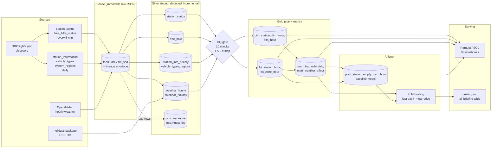

# Architecture: ingestion to serving, with an AI layer

## Why each piece

| Stage | Choice | Reason |
|---|---|---|
| Extract | Discovery-first from `gbfs.json`, re-read hourly | Feed URLs and versions change; GBFS 3.0 renames `free_bike_status`. Nothing else is hardcoded |
| Polling | `max(ttl, 5 min)` for realtime, daily for reference, hourly for weather | Respects the feed's ttl; 5-minute resolution is plenty for hourly metrics |
| Bronze | Raw JSON + envelope, partitioned `feed/dt=`, atomic writes | Full replay; schema changes never lose data |
| Silver | Incremental via `ops.ingest_log`, PK + `INSERT OR IGNORE`, quarantine table | Idempotent: re-running or double-polling can't duplicate rows |
| DQ gate | PASS/WARN/FAIL checks persisted to `ops.dq_results` | Bad data stops at silver; gold keeps the last good version |
| Gold | Full rebuild inside one transaction | Cheap at this size; logic changes and backfills are trivial; readers never see a half-built state |
| AI | On top of gold only | Consumes curated, tested data; produces derived, auditable artifacts |
| Serving | DuckDB tables + Parquet exports + markdown briefing | Any BI tool or notebook can read Parquet |

## Production mapping (Azure / Databricks)

| Local (this repo) | Production |
|---|---|
| `run_pipeline.py live` loop | Databricks Workflow (or Airflow) on a 5-min schedule; Azure Function for the poller if sub-minute |
| `data/bronze/*.json` | ADLS Gen2 landing zone → Auto Loader → Delta bronze |
| Silver Python parsers + PKs | Lakeflow Declarative Pipelines (DLT) with expectations, or Delta MERGE on `(station_id, snapshot_ts)` |
| `ops.quarantine` | DLT expectation `ON VIOLATION` → quarantine table |
| Gold SQL files | dbt models or Databricks SQL, incremental by hour partition; Unity Catalog for governance/lineage |
| DQ gate | DLT expectations + a gating task in the Workflow |
| Baseline predictor | Feature table + LightGBM/AutoML, tracked and served with MLflow |
| LLM briefing | Anthropic API / Databricks Model Serving; Genie space for NL queries over gold |
| Parquet serving | Databricks SQL warehouse → Power BI / dashboards |

The same design works on Snowflake: Snowpipe into a VARIANT bronze table, dbt for silver/gold with tests, Cortex or an external LLM for the AI layer.

## Scaling notes

- Volume: ~800 stations x 288 polls/day ≈ 230k station rows/day plus ~100-300k free-bike rows/day. Small data; DuckDB handles months on a laptop. Bronze compacts to Parquet daily if needed.
- Gold switches from full rebuild to incremental (rebuild only the last N hours) once history passes a few months.
- Station and zone dimensions are tiny; the hourly facts are the only tables that grow.
